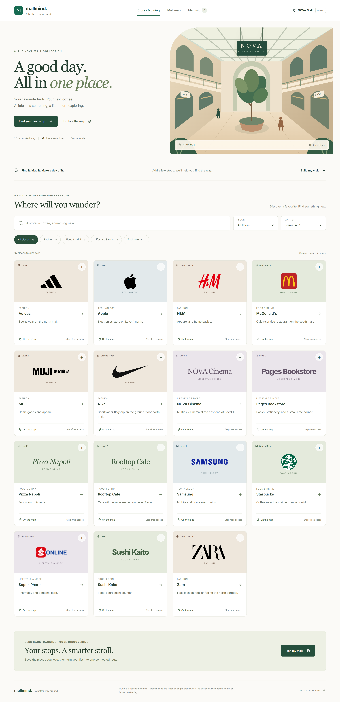
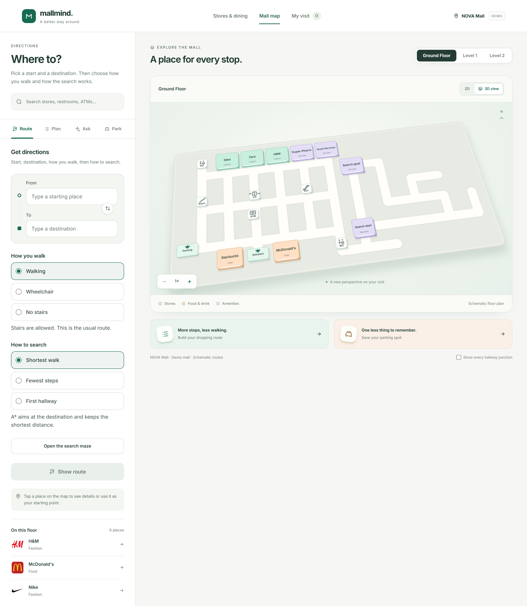
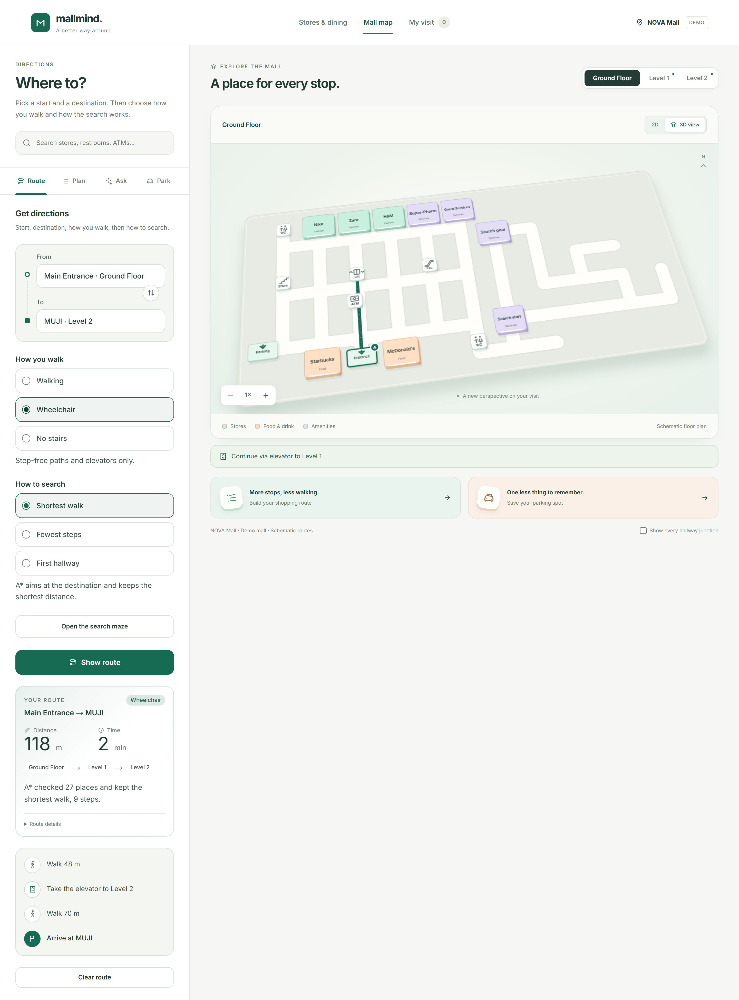
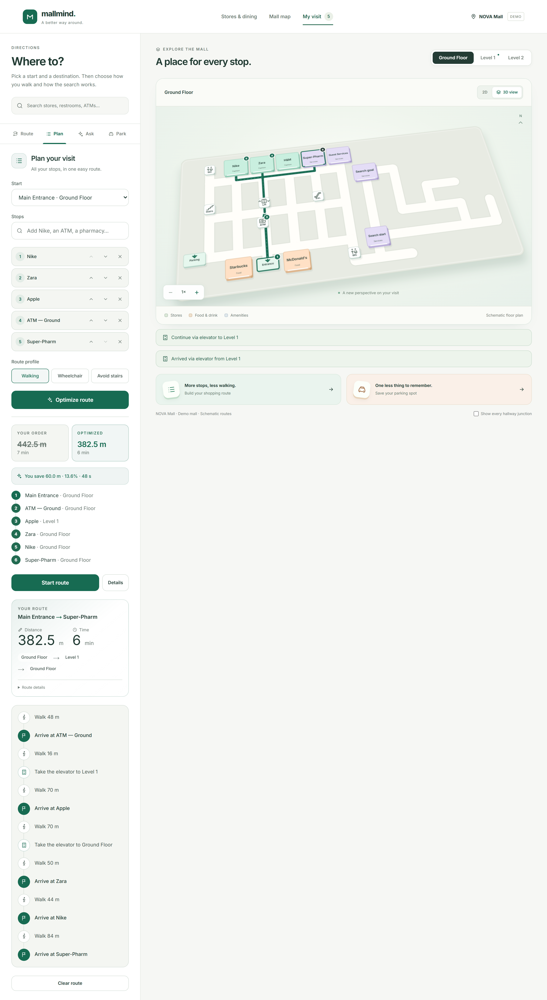
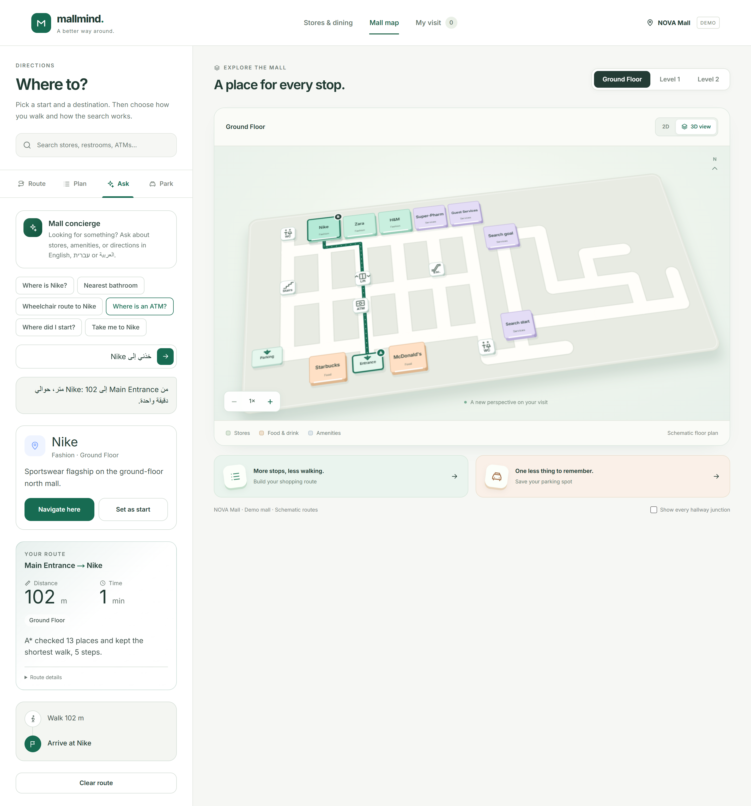
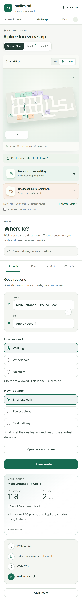
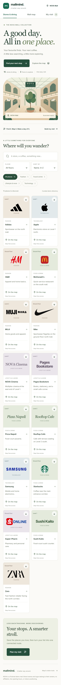

# MallMind — Indoor Navigation & Shopping Trip Planner

An interactive mall guide with a searchable store directory, accessible routes, multilingual search, trip optimization, and private parking memory.



**[Try the demo in 90 seconds](docs/demo-walkthrough.md)** · **[Engineering case study](docs/portfolio-case-study.md)** · **[Run locally or deploy](docs/deployment.md)** · **[CV project entry](docs/cv-project-entry.md)**

Portfolio demo built around fictional NOVA Mall. The map is schematic; it does not locate your phone or provide surveyed indoor navigation. **[Source code](https://github.com/Bas1925/MallMind)** · **[CI runs](https://github.com/Bas1925/MallMind/actions)**. Public demo hosting is not configured; use the local setup or walkthrough below.

No real mall, GPS hardware, account, or paid API key is needed to try the simulation. The default setup uses synthetic map data, lexical search, and multilingual template responses. Brand logos identify demo listings, not partnerships; [asset sources and rights](docs/brand-assets.md).

## What you can try

- **Discover:** browse 15 seeded stores and dining spots, combine category/floor/search filters, inspect store details, and add stops to a shared visit list.
- **Explore:** switch floors, select stores, use keyboard search, and toggle the dimensional or flat map.
- **Route:** choose endpoints and a standard, wheelchair, or avoid-stairs route. Floor-specific paths and instructions come from the backend.
- **Compare searches:** use the service-maze example to visualize BFS and DFS traversal alongside shortest-distance routing. Fewest graph edges is not the same as the shortest walking distance.
- **Plan:** order multiple stops using exact optimization for small trips and heuristics for larger ones.
- **Ask:** find places and routes in English, Hebrew, or Arabic. Unknown places receive a grounded refusal.
- **Park:** save level, zone and spot locally, then route back to a mapped entrance.

<details>
<summary>Map, route, trip planner, concierge, and mobile screenshots</summary>








</details>

## Engineering worth discussing

| Decision | Why it matters |
|---|---|
| A* with an independent Dijkstra baseline | Checks shortest-path correctness and exposes search effort |
| BFS/DFS visualization on a seeded service maze | Demonstrates traversal order and the difference between shortest distance, fewest edges, and first-found paths |
| Directed graph + accessibility filters | Models one-way links and unavailable step-free paths |
| Held–Karp up to 12 stops; nearest-neighbor + directed 2-opt beyond | Makes the quality/runtime tradeoff explicit |
| PostgreSQL + pgvector + pg_trgm | Structured map data, fuzzy lexical search and optional embeddings |
| Abortable requests and invalidated results | Prevents outdated routes, searches and assistant actions from changing the current view |
| Device-local parking storage | Persistence without collecting vehicle or location data on a server |

The client uses Next.js, React, strict TypeScript and Tailwind. FastAPI services separate HTTP handlers, search, routing and database access. The assistant supports optional model integration; the verified baseline uses database-grounded multilingual templates and lexical search without paid APIs.

## Measured results

On the current NOVA seed (3 floors, 33 places, 110 nodes, 288 directed edges), re-run on **13 October 2026**:

- **13.6% shorter** five-stop example: 442.5 m → 382.5 m.
- **62.0% fewer node expansions** for Main Entrance → MUJI: A* expands 27 versus Dijkstra's 71, with the same 118 m cost.
- Both algorithms expand all 10,000 nodes on the opposite-corner synthetic grid benchmark; A* is not always faster.

These are reproducible experiments, not general performance guarantees or real-customer measurements. See the [case study](docs/portfolio-case-study.md) for methods and limitations.

## Verification

Local verification is recorded in [the publication preparation report](docs/publication-readiness.md). The improvements cover delayed requests, keyboard search, trip editing, parking persistence, accessible routing, and desktop/mobile browser journeys against a real API and PostgreSQL.

GitHub Actions workflows run from the actual repository root. Check [the current workflow results](https://github.com/Bas1925/MallMind/actions) for hosted verification; the local results in the report are separate evidence.

Before publishing, run `node --test scripts/check-publication.test.mjs` and `node scripts/check-publication.mjs --history` from this directory. The guard checks private/generated paths and common credential patterns without printing matches; it is not a complete security audit. See the [publication checklist](docs/github-publication.md).

## Quick start

With Docker running, from the directory containing this README:

```sh
docker compose up -d --build postgres backend
docker compose exec backend alembic upgrade head
docker compose exec backend python -m app.seed
docker compose up -d --build frontend
```

Open http://localhost:3000. The seed refuses to overwrite an existing mall. For native setup, required extensions, dedicated test databases, production containers, and verification commands, see [deployment](docs/deployment.md).

## Project map

```text
frontend/   Next.js visitor guide, component tests and browser journeys
backend/    FastAPI, graph algorithms, search, migrations and tests
docs/       Design decisions, benchmarks, debugging stories and case study
.github/    Frontend, backend and browser-test workflows
```

[Original phase-by-phase notes](docs/verification-history.md) are retained as historical records, not current CI evidence. [Open-source license](LICENSE): MIT.
