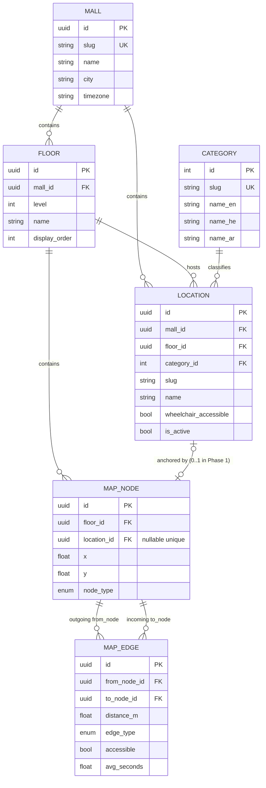

# 02 — Phase 1 Design: Data Model and Mall Domain

**Status:** Approved, 2026-10-06.
**Scope:** The six MVP tables (`malls`, `floors`, `categories`, `locations`, `map_nodes`, `map_edges`), their relationships, constraints, indexes, the seed data for NOVA Mall, and the validator that guards it.

This document is intentionally written **before** the code. Every table, constraint, and column choice below should trace back to a *reason*, not an aesthetic.

---

## 1. The two most important design decisions

Two conceptual choices shape every table that follows. Get these right and the rest is bookkeeping.

### 1.1 `Location` and `MapNode` are separate concepts

A **Location** is a *thing a user searches for*. "Nike." "Bathroom." "ATM." "Zara."
A **MapNode** is a *vertex in the navigation graph*. It has (x, y) coordinates and a floor.

These are not the same thing. Collapsing them is tempting (one table, "a store is a graph vertex, done") and wrong.

| Reason to separate | Why it matters |
|---|---|
| **A location can have multiple nodes.** A big-box store with two entrances is one brand but two walking targets. We model this later as `MapNode.location_id` being set on both nodes. In Phase 1 we constrain to 1:1 for simplicity. | Future-proofing without over-engineering now. |
| **Many nodes have no location.** Hallway intersections and elevator landings exist in the graph but aren't user-visible. Forcing them into `locations` pollutes search and category pickers. | Keeps the search surface clean. |
| **Graphs get rebuilt.** When we re-survey a mall or split a long corridor into finer segments for better routing, we add/move/merge nodes without touching the stable Location catalog (which is what users and the AI assistant have memorised). | Churn in geometry doesn't cascade. |
| **Different edit cadences.** Store names and categories change rarely. Graph topology is tweaked often during tuning. Separating lets each table evolve on its own rhythm. | Operational simplicity. |

**Direction of the relationship.** In Phase 1, `MapNode.location_id` (nullable, unique) is the FK. The alternative — `Location.map_node_id` — is also valid but awkward: in the "a store has two entrances" future it has to become `Location.primary_node_id` plus a separate linkage table. Starting from the node side is extensible without refactoring the Location table.

### 1.2 Edges are **directed**, bidirectional pairs are stored as two edges

The physical world has directed connections:

- **Escalators are one-way.** An up-escalator landing on Floor 1 reaches the up-escalator landing on Floor 2. Not the other way around.
- **Some fire-exit stairs are descent-only** (handle on one side).
- **Some one-way corridors** exist in real malls (service passages, security routing).

We could model edges as undirected with a boolean and apply direction at traversal time. Done that way, A* needs special-case logic ("if this edge is one-way, only expand in direction X"). Error-prone.

Modeling edges as **directed by default** and storing bidirectional connections as **two symmetric edges** (A→B and B→A) is cleaner:

- A* becomes a one-liner lookup of outbound edges from the current node.
- Costs can differ by direction (an elevator going down waits less than one going up — in Phase 2 we may encode this).
- Database constraints are easier (uniqueness per `(from, to)`), as opposed to needing a canonical order.

The cost is 2× rows for the common case. For a few thousand edges this is irrelevant. Documented in ADR-008.

---

## 2. Table-by-table

### 2.1 `malls`

```
malls
├── id            UUID PK
├── slug          TEXT UNIQUE NOT NULL         ("nova-mall")
├── name          TEXT NOT NULL                ("NOVA Mall")
├── city          TEXT NULL
├── timezone      TEXT NOT NULL DEFAULT 'UTC'  (future hours queries)
├── created_at    TIMESTAMPTZ NOT NULL DEFAULT now()
└── updated_at    TIMESTAMPTZ NOT NULL DEFAULT now()
```

Even with one mall, we keep this table because:
- Scoping unique slugs by mall is natural (`UNIQUE (mall_id, slug)` on locations).
- Future multi-tenancy slot without a migration.
- Admin UI (Phase 2+) can list malls.

### 2.2 `floors`

```
floors
├── id            UUID PK
├── mall_id       UUID NOT NULL REFERENCES malls(id) ON DELETE RESTRICT
├── level         INTEGER NOT NULL             (-2, -1, 0, 1, 2 ... semantics up to the mall)
├── name          TEXT NOT NULL                ("Ground", "L1", "Rooftop")
├── display_order INTEGER NOT NULL             (what order to render floor pickers in; usually matches `level`)
└── UNIQUE (mall_id, level)
```

**Why both `level` and `display_order`?** Some malls label floors non-linearly ("LG", "G", "M", "1", "2"). `level` is the arithmetic position used for routing cost; `display_order` is the UI render order. They *usually* agree but shouldn't be assumed to.

### 2.3 `categories`

```
categories
├── id        INTEGER PK (small, serial — categories are a short enum-ish list)
├── slug      TEXT UNIQUE NOT NULL
├── name_en   TEXT NOT NULL
├── name_he   TEXT NOT NULL
└── name_ar   TEXT NOT NULL
```

**Flat, not hierarchical.** The user asked explicitly. For "Fashion > Shoes > Running" we'd need a tree, breadcrumbs, and query-with-descendants logic. The MVP needs a flat list ("Fashion", "Electronics", "Food", "Services", "Restroom", etc.). If the catalog grows past ~30 categories, we revisit.

Multilingual name columns baked in because the whole product is tri-lingual. We don't go full `translations` table yet — that's warranted when the number of translatable fields explodes.

### 2.4 `locations`

```
locations
├── id                 UUID PK
├── mall_id            UUID NOT NULL REFERENCES malls(id) ON DELETE RESTRICT
├── floor_id           UUID NOT NULL REFERENCES floors(id) ON DELETE RESTRICT
├── category_id        INTEGER NOT NULL REFERENCES categories(id) ON DELETE RESTRICT
├── slug               TEXT NOT NULL
├── name               TEXT NOT NULL
├── description        TEXT NULL
├── wheelchair_accessible BOOLEAN NOT NULL DEFAULT TRUE  (store-level override)
├── is_active          BOOLEAN NOT NULL DEFAULT TRUE
├── created_at         TIMESTAMPTZ NOT NULL DEFAULT now()
├── updated_at         TIMESTAMPTZ NOT NULL DEFAULT now()
└── UNIQUE (mall_id, slug)
```

**What belongs here vs. elsewhere?**

| Field | Here | Elsewhere | Why |
|---|---|---|---|
| `name` | ✅ |  | Universally queried alongside the location. |
| `description` | ✅ |  | Short free text. If it becomes rich / versioned, it migrates to `location_descriptions`. |
| hours | 🚫 | Future `location_hours` table | Variable shape per store; day/holiday overrides; its own CRUD. Not needed for Phase 1 routing. |
| phone | 🚫 | Future `location_contacts` table | Multiple contacts possible; not routing-critical. |
| images | 🚫 | Future `location_assets` | Lots of them, versions, URLs. |
| `wheelchair_accessible` | ✅ |  | A single boolean that short-circuits route-planning in `accessible` mode. Will combine with per-edge accessibility. |
| `is_active` | ✅ |  | Soft-delete without losing navigation history. |

**No searchable text column yet.** Phase 4 adds `search_text` (concatenation of name/alias/category/description) with a trigram index. Keep that migration separate from the schema that models the domain. Mixing search optimisation into the first migration ties them unnecessarily.

### 2.5 `map_nodes`

```
map_nodes
├── id            UUID PK
├── floor_id      UUID NOT NULL REFERENCES floors(id) ON DELETE RESTRICT
├── location_id   UUID NULL UNIQUE REFERENCES locations(id) ON DELETE SET NULL
├── x             DOUBLE PRECISION NOT NULL
├── y             DOUBLE PRECISION NOT NULL
├── node_type     NODE_TYPE_ENUM NOT NULL
└── created_at    TIMESTAMPTZ NOT NULL DEFAULT now()
```

- `location_id` is nullable (most nodes are pure graph geometry; hallway junctions, elevator landings, etc.).
- `location_id` is **unique** when set — Phase 1 enforces 1 node per location. Multi-anchor is a Phase 2 enhancement that drops this.
- `(x, y)` are **floor-local doubles**. See ADR-007 for the full discussion.

**`node_type` enum values:**

```
hallway_junction
store_anchor
entrance
exit
bathroom
atm
elevator_landing
stairs_landing
escalator_up_landing
escalator_down_landing
info_desk
```

### 2.6 `map_edges`

```
map_edges
├── id              UUID PK
├── from_node_id    UUID NOT NULL REFERENCES map_nodes(id) ON DELETE RESTRICT
├── to_node_id      UUID NOT NULL REFERENCES map_nodes(id) ON DELETE RESTRICT
├── distance_m      DOUBLE PRECISION NOT NULL          -- meters; 0.0 permitted only for vertical connectors
├── edge_type       EDGE_TYPE_ENUM NOT NULL
├── accessible      BOOLEAN NOT NULL                   -- "accessible" mode may use this
├── avg_seconds     DOUBLE PRECISION NOT NULL          -- time cost; A* can minimise distance OR time
├── created_at      TIMESTAMPTZ NOT NULL DEFAULT now()
├── CHECK (distance_m >= 0.0)
├── CHECK (avg_seconds > 0.0)
├── CHECK (from_node_id != to_node_id)
└── UNIQUE (from_node_id, to_node_id)
```

**`edge_type` enum values:**

```
hallway
stairs
elevator
escalator_up
escalator_down
```

**Why `distance_m` can be zero.** An elevator spans no horizontal distance; its *cost* is the wait time, encoded in `avg_seconds`. Horizontal (hallway) edges must have `distance_m > 0`, enforced in the validator but relaxed to `>= 0.0` at the DB level to permit vertical zero-distance connectors.

**Why both `distance_m` and `avg_seconds`?**

- Future route-mode toggle: minimise distance (user prefers short walk) vs minimise time (user prefers to arrive sooner, accepting an elevator wait).
- Both are cheap to store; recomputing one from the other is lossy (walking-speed varies, elevator waits are not derivable from meters).

---

## 3. How vertical connections work

For a 3-floor mall with an elevator shaft:

- Floor 1 has `elevator_landing` node `E1`.
- Floor 2 has `elevator_landing` node `E2`.
- Floor 3 has `elevator_landing` node `E3`.
- 6 directed edges connect them pairwise: `E1↔E2`, `E2↔E3`, `E1↔E3`. Yes, we add the skip-floor edges too, with slightly higher `avg_seconds` to model multi-floor wait + travel. Omitting them would force A* to always route through intermediate landings, which is physically wrong (an elevator skips).

  (Actually: for the MVP seed we'll be more conservative and only add adjacent-floor edges. If routing ends up visiting intermediate floors unnecessarily often, we add the skips in Phase 2. Noted here so future-me knows the trade-off.)

For escalators, which are one-way:

- Floor 1 has `escalator_up_landing` node `U1` (bottom of up-escalator going to F2).
- Floor 2 has `escalator_up_landing` node `U2`.
- One directed edge: `U1 → U2`. No reverse.
- Separately, `D2 → D1` as the down-escalator pair.

**Accessibility.** Elevator edges have `accessible = true`. Stairs and escalators have `accessible = false`. Hallway edges are typically `true` but a specific corridor could be marked otherwise if it has steps.

---

## 4. Indexes (driven by actual queries)

Reasoning before adding indexes: what will we actually run?

| Query | Access pattern | Index |
|---|---|---|
| "Load the whole graph on backend startup" | `SELECT * FROM map_nodes WHERE mall_id IN (SELECT id FROM malls WHERE slug = ?)` + `SELECT * FROM map_edges WHERE from_node_id IN (…)` | FK indexes on `floor_id`, `from_node_id` (which Alembic/SQLAlchemy auto-adds for FKs) are enough. |
| "A* neighbour expansion" | Runs **in memory** after startup. Doesn't touch DB. | None required. |
| "Find location by slug" | `WHERE mall_id = ? AND slug = ?` | `UNIQUE (mall_id, slug)` already serves as the index. |
| "List locations on floor X" | `WHERE floor_id = ?` | B-tree on `locations.floor_id` (FK index). |
| "List locations in category Y" | `WHERE category_id = ?` | B-tree on `locations.category_id` (FK index). |
| Trigram substring search (`WHERE name ILIKE '%nike%'`) | Phase 4 | **Not added in Phase 1.** Separate migration later. |
| Semantic vector search | Phase 5 | Not added in Phase 1. |

Rule applied: **don't add an index unless there's a query that needs it.** Indexes aren't free; they slow writes and consume disk. For the seed loader, which inserts hundreds of rows at once, fewer indexes means a faster seed and less chance of a dead-tuple bloat problem later.

---

## 5. Constraints — DB vs Python

| Invariant | Enforced in | Why |
|---|---|---|
| Primary keys are unique | DB (PK) | Structural. Impossible to break without disk corruption. |
| Slugs are unique within a mall | DB (`UNIQUE (mall_id, slug)`) | Protects the search contract; also prevents accidental duplicates during seeding. |
| Edge distance ≥ 0 | DB (`CHECK (distance_m >= 0)`) | A negative distance has no physical meaning; stops bugs cold. |
| Edge time > 0 | DB (`CHECK (avg_seconds > 0)`) | Same. |
| No self-loop edges | DB (`CHECK (from_node_id != to_node_id)`) | Would make A* loop forever on bad data. |
| No duplicate edges (A→B stored twice) | DB (`UNIQUE (from_node_id, to_node_id)`) | A duplicate edge would double-count during traversal. |
| Elevator edges must connect **same (x, y)** on **different** floors | Python validator | Requires joining `map_nodes` on both sides to check — too complex for a `CHECK` constraint. |
| Escalator-up must go upward (floor_number increases) | Python validator | Same — requires joining. |
| Every location has exactly one anchor node | Python validator | Multi-table structural claim; DB can enforce "at most one" via `UNIQUE (map_nodes.location_id)` but not "at least one" without a trigger. We use the validator for the "at least one" half. |
| No orphan graph components | Python validator (reachability check) | Needs BFS over the whole graph. Validator-friendly, DB-hostile. |
| Node coordinates fall within reasonable floor bounds | Python validator (optional) | Soft business rule; floor dimensions aren't persisted. |

**Rule of thumb:** if a corrupt row would silently break production and the check doesn't require joining multiple tables, put it in the DB. Everything else goes in Python — richer errors, test-friendly, no migration overhead.

---

## 6. Seed validator — what it catches

The validator runs **against the parsed JSON**, before any DB work. If it fails, nothing is inserted. Checks:

1. **Reference integrity**
   - Every `node.floor_id` references a floor in the same seed.
   - Every `edge.from_node_id` / `edge.to_node_id` references a node in the same seed.
   - Every `location.floor_id` references a floor; `category_id` references a category; the `anchor_node_id` references a node.

2. **Uniqueness**
   - Mall slug, floor levels within a mall, category slugs, location slugs within a mall, node ids, edge (from, to) pairs — all unique within the seed.

3. **Numeric sanity**
   - Edge `distance_m >= 0` (DB will enforce this too, but failing fast is better UX).
   - Hallway edge `distance_m > 0` (zero-distance walking edge is meaningless).
   - Edge `avg_seconds > 0`.

4. **Topology**
   - No self-loop edges (`from == to`).
   - No duplicate directed edges.
   - Each location has exactly one anchor node.
   - That anchor node's `node_type` is `store_anchor` (or a facility-specific type for bathrooms/ATMs/etc.).
   - Elevator / stairs edges connect nodes on **different** floors.
   - Hallway edges connect nodes on the **same** floor.
   - Escalator-up edges go from lower floor to higher floor; escalator-down the opposite.

5. **Reachability (graph integrity)**
   - BFS from the first `entrance`-type node reaches every `store_anchor`.
   - If any store is unreachable in `normal` mode, abort and name it.
   - A separate pass reports stores unreachable in `accessible` mode (we only *warn* here — some stores legitimately have only a stair entrance, and that's for the UI to surface, not for us to reject).

6. **Node orphans**
   - Report (but do not reject) nodes that have no incoming or outgoing edges. These are usually seed bugs but may legitimately be "future planned expansion" placeholders.

**Failure behaviour:** validator returns a structured list of `ValidationError(kind, message, location)` — never raises on the first error, always collects everything so a single run shows every problem.

---

## 7. Alembic strategy

Covered in detail in [`decisions/006-alembic-migration-strategy.md`](decisions/006-alembic-migration-strategy.md). Summary:

- Alembic manages all schema changes. **No `Base.metadata.create_all()` in production code paths.** It's fine as a convenience in a local test-DB fixture.
- Autogenerate is a *starting draft*, not the final migration. Every migration is reviewed by a human — especially for ENUM creation/drop, column rename vs. drop-and-add, and anything involving `pgvector` columns (which autogenerate can't handle).
- Migrations are the authoritative source of DB truth. If `pyproject.toml` or `models/` disagrees with `alembic/versions/`, the migrations win.

---

## 8. Repository / service boundary for Phase 1

Phase 1 has two real callers of the same insert/delete sequence: `python -m app.seed` and the Postgres integration test. That is enough to extract:

- `app/repositories/seed_repository.py` — FK-sensitive insert order and mall-graph delete
- `app/services/seed_service.py` — validate, refuse if already seeded, `--force` replace

There is still no generic `MallRepository` / `LocationRepository`. Those appear when a second *query* caller exists (routing, search). The seed boundary exists because duplicating the delete order (edges → nodes → locations → floors → mall) in two places is how RESTRICT foreign keys get "fixed" by accident.

The seed itself is a Python builder (`app/seed/nova_mall.py`) that emits a `SeedDocument`. A 90-node / 200-edge graph is a generator problem, not a JSON-editing problem. The validator still treats the document as untrusted — tests mutate copies to prove it can fail.

---

## 9. Assumptions this phase makes

| Assumption | If wrong, we… |
|---|---|
| The seed is built by `app/seed/nova_mall.py` (small enough to construct in-memory) | …switch to streaming or chunked loading |
| Seed loader is idempotent (safe to re-run; detects "already seeded" and refuses, with `--force` to re-seed from scratch) | …add that behaviour on first bug report |
| Integration tests can assume a clean database per run (migrations+seed from empty) | …add teardown + a `tests_mallmind_test` database alongside the dev DB |
| The Postgres running the integration tests has `pgvector` and `pg_trgm` installed (so migrations referencing `vector` columns in Phase 5 succeed) | …fix the Alembic env.py to `CREATE EXTENSION` idempotently as the first migration step |

---

## 10. What this phase deliberately does NOT do

- No routing (A*, Dijkstra). Phase 2.
- No search (text or vector). Phase 4.
- No auth, parking. Phase 7.
- No embeddings or RAG. Phase 5.
- No admin UI, no seed-editor UI, no map editor. Deliberately.
- No repository abstractions beyond what the seed loader uses.
- No performance tuning beyond "indexes we'll obviously need."

Phase 1 is **"model the mall truthfully and prove the data is sane."** Everything else builds on this.

## 11. ER diagram


